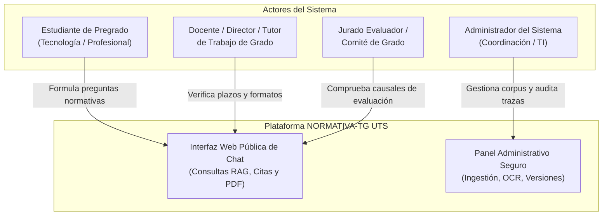
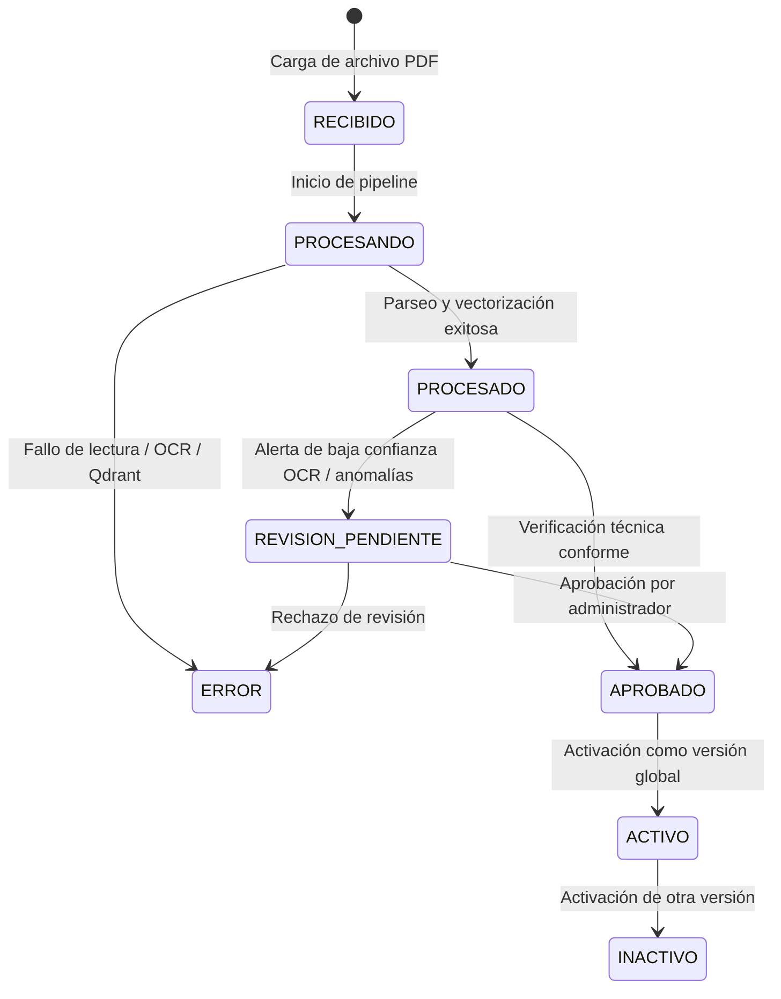

# Documento de Análisis y Especificación de Requisitos de Software
## Proyecto: Asistente Inteligente RAG para el Reglamento de Trabajo de Grado UTS (NORMATIVA-TG UTS)
**Código Institucional:** F-DC-124 / F-DC-125  
**Institución:** Unidades Tecnológicas de Santander (UTS)  
**Fecha de consolidación:** Noviembre de 2026  
**Estado:** Versión Final de Entrega Técnica  

---

## 1. Introducción y Contexto Institucional

El presente documento constituye la especificación formal de ingeniería y análisis de requisitos para el sistema **NORMATIVA-TG UTS**, desarrollado como proyecto de grado bajo la modalidad de desarrollo tecnológico según las directrices institucionales del formato **F-DC-124** y como base técnica para el informe final **F-DC-125**.

El proyecto surge ante la necesidad de agilizar, democratizar y brindar certeza orientativa a la comunidad académica (estudiantes, directores de proyecto, evaluadores y comités de trabajo de grado) de las Unidades Tecnológicas de Santander respecto a las disposiciones, deberes, plazos, modalidades y trámites contenidos en el **Reglamento de Trabajo de Grado institucional**. 

El sistema implementa una arquitectura **RAG (Retrieval-Augmented Generation)** completamente local y soberana, erradicando cualquier dependencia de proveedores de computación en la nube o APIs comerciales externas, garantizando la confidencialidad, gratuidad y reproducibilidad técnica del prototipo.

---

## 2. Análisis y Caracterización del Reglamento de Trabajo de Grado

El corpus normativo primario del proyecto corresponde al **Acuerdo No. 01-021 del 18 de julio de 2019**, expedido por el Consejo Directivo de las Unidades Tecnológicas de Santander, mediante el cual se adoptó el Reglamento de Trabajo de Grado vigente.

### 2.1. Naturaleza Documental y Retos Físicos
- **Formato fuente:** Documento digitalizado en PDF de 19 páginas.
- **Calidad de digitalización:** El documento oficial no cuenta con una capa de texto digital nativa vectorizada; se trata de una digitalización rasterizada (escaneo) de resolución media, con sellos institucionales, encabezados y pies de página recurrentes en cada folio, firmas autógrafas en la página final e imperfecciones ópticas leves (inclinación de texto, artefactos de compresión y caracteres desgastados).
- **Tipografía y diagramación:** Texto a una sola columna en cuerpo principal, títulos centrados en mayúsculas sostenidas, subtítulos numerados con números romanos y arábigos, parágrafos con sangría e incisos rotulados alfabéticamente (`a)`, `b)`, `c)`...).

### 2.2. Estructura Jerárquica del Corpus Normativo
El análisis estructural determinó que el documento se divide en dos niveles formales:
1. **Parte Resolutiva del Acuerdo:**
   - Preámbulo y considerandos institucionales (páginas 1 a 3).
   - Artículos del Acuerdo (`ARTÍCULO PRIMERO`, `ARTÍCULO SEGUNDO`, `ARTÍCULO TERCERO`), donde el primero adopta formalmente el cuerpo del reglamento.
2. **Cuerpo Sustantivo del Reglamento de Trabajo de Grado:**
   - **16 Capítulos:** Identificados mediante numeración romana (`CAPÍTULO I` a `CAPÍTULO XVI`).
   - **64 Artículos sustantivos:** Numerados correlativamente del 1 al 64.
   - **36 Parágrafos:** Disposiciones aditivas o condicionales asociadas a los artículos (`Parágrafo 1`, `Parágrafo 2`, `Parágrafo único`).
   - **89 Incisos y literales:** Enumeraciones taxativas de requisitos, modalidades, causales y procedimientos.

| Componente Estructural | Cantidad Contabilizada | Reto de Procesamiento |
| :--- | :---: | :--- |
| **Páginas del documento** | 19 | Exige procesamiento OCR completo (100% páginas escaneadas). |
| **Capítulos normativos** | 16 | Detección de títulos temáticos sin confundirlos con el cuerpo. |
| **Artículos de reglamento** | 64 | Preservación del número de artículo ante ruido tipográfico. |
| **Artículos de acuerdo** | 3 | Diferenciación entre parte dispositiva del acuerdo y articulado del reglamento. |
| **Parágrafos específicos** | 36 | Mantenimiento del vínculo subordinado al artículo padre. |
| **Incisos y literales** | 89 | Segmentación atómica sin perder la relación con el encabezado. |

---

## 3. Caracterización de Usuarios y Tipos de Consultas

### 3.1. Roles y Perfiles de Usuario



1. **Estudiante de Pregrado (Tecnológico / Universitario):**
   - *Objetivo:* Conocer los requisitos para iniciar grado, modalidades disponibles según su nivel de formación, plazos de entrega del informe, conformación de grupos y procedimientos de sustentación.
   - *Comportamiento:* Lenguaje coloquial, formulación de preguntas a menudo ambiguas ("¿cuántos días tengo?", "¿puedo hacerlo con un amigo?").
2. **Director / Tutor de Trabajo de Grado:**
   - *Objetivo:* Validar plazos de revisión, causales de aplazamiento, responsabilidades del tutor, número máximo de proyectos dirigidos simultáneamente.
3. **Comité de Trabajo de Grado / Jurado Evaluador:**
   - *Objetivo:* Consultar criterios exactos de evaluación cualitativa (Aprobado, Aplazado, Reprobado), causales de anulación, términos de respuesta formal y prórrogas excepcionales.
4. **Administrador del Sistema (TI / Coordinación Académica):**
   - *Objetivo:* Cargar nuevos acuerdos modificatorios o reglamentos actualizados, supervisar la calidad del OCR, revisar advertencias de parseo, aprobar versiones y activar formalmente la normativa vigente para que el motor RAG opere exclusivamente sobre ella.

### 3.2. Taxonomía de Consultas Atendidas por el Asistente

| Categoría de Consulta | Descripción Operativa | Ejemplo Real del Banco de Validación |
| :--- | :--- | :--- |
| **Directa Sustentada (D)** | Consultas puntuales sobre un artículo específico cuyo contenido es taxativo. | *D01: "¿Cuáles son las modalidades de Trabajo de Grado contempladas en el reglamento?"* |
| **Relación entre Disposiciones (R)** | Consultas complejas que exigen cruzar dos o más artículos para brindar una respuesta integral sin omitir condiciones. | *R10: "Me aprobaron la propuesta. ¿Qué debo hacer después y cuándo puedo presentar el Informe Final?"* |
| **Parágrafos y Excepciones (E)** | Consultas sobre excepciones normativas que impiden aplicar la regla general. | *E15: "¿La modalidad de Seminario admite prórroga?"* |
| **Ambigua o Parcial (A)** | Preguntas con información incompleta que requieren orientación preliminar e invitación explícita a clarificar. | *A19: "¿Cuántos días tengo para hacer el informe?"* |
| **Sin Evidencia Suficiente (S)** | Consultas sobre aspectos que no están regulados en el PDF (datos operativos, valores pecuniarios vigentes, correos específicos). | *S23: "¿Cuál es el valor exacto en pesos que debo pagar por Seminario este año?"* |
| **Fuera de Alcance (F)** | Consultas completamente ajenas al dominio académico y normativo de las UTS. | *F26: "¿Cuál es el precio de una hamburguesa?"* |
| **Aislamiento de Versiones (V)** | Comprobación de que el motor responde únicamente con base en la versión activa seleccionada. | *V29 y V30: Consulta idéntica alternando versión 2019 y versión secundaria.* |

---

## 4. Alcance y Limitaciones del Sistema

### 4.1. Alcance
- Operación **100% local**: Backend FastAPI, frontend React, base de datos vectorial Qdrant (Docker), LLM local (`qwen2.5:7b`) y embeddings locales (`bge-m3`) vía Ollama, y base de datos relacional SQLite (`sqlite3`).
- Ingestión documental automatizada con extracción híbrida (capa digital o fallback transparente a OCR en español vía Tesseract a 300 DPI con `pypdfium2`).
- Limpieza determinista de encabezados, números de página, notas marginales y pies de página recurrentes.
- Segmentación jerárquica conservando la estructura normativa: Capítulo, Artículo, Parágrafo, Inciso, Página de inicio y fin, Documento y Versión.
- Aislamiento estricto por `version_id` en todas las operaciones vectoriales y relacionales.
- Generación de citas deterministas fundamentadas exclusivamente en los metadatos de los chunks recuperados, prohibiendo terminantemente la invención de citas por parte del LLM.
- Trazabilidad y auditoría de cada consulta formulada en el sistema mediante identificador único UUID, métricas de latencia de recuperación y generación, chunks utilizados y estado de abstención.
- Interfaz pública responsiva para estudiantes y panel privado protegido mediante cookie HttpOnly y token administrativo.

### 4.2. Limitaciones
- **Carácter estrictamente orientativo:** El sistema incluye en cada respuesta un disclaimer que aclara que el asistente no emite actos administrativos ni decisiones vinculantes; las decisiones formales corresponden a la Secretaría Académica y Comités de Grado de la UTS.
- **Dependencia de la calidad del documento fuente:** Si el documento original presenta manchas severas o mutilaciones en el escaneo, la confianza OCR puede descender en páginas específicas (por ejemplo, página 2 con 75.5%).
- **Hardware local requerido:** Al ejecutar modelos de lenguaje de 7B parámetros (`qwen2.5:7b`) e incrustaciones densas (`bge-m3`), el tiempo de respuesta varía según la aceleración de hardware (GPU con soporte CUDA/ROCm vs CPU multi-core).

---

## 5. Especificación de Requisitos de Software

### 5.1. Requisitos Funcionales (RF)

| Código | Denominación | Descripción Detallada |
| :--- | :--- | :--- |
| **RF-01** | Ingestión Documental PDF | El sistema debe permitir la carga de archivos oficiales en formato PDF correspondientes a acuerdos y reglamentos de trabajo de grado de la UTS, calculando su hash SHA-256 para control de integridad. |
| **RF-02** | Extracción Híbrida y OCR | El motor de ingestión debe evaluar la presencia de capa de texto digital nativa; si la página contiene menos de 50 caracteres o se fuerza OCR, debe ejecutar extracción óptica mediante Tesseract OCR en español (`spa`) a 300 DPI. |
| **RF-03** | Limpieza Estructural | El sistema debe detectar y suprimir automáticamente líneas repetitivas posicionales (encabezados institucionales y pies de página con direcciones/teléfonos) e índices temáticos, preservando el articulado normativo. |
| **RF-04** | Parseo y Chunking Jerárquico | El sistema debe desestructurar el texto limpio en unidades mínimas coherentes (artículos completos, parágrafos subordinados e incisos), preservando metadatos completos: capítulo, artículo, parágrafo, inciso, páginas y confianza OCR. |
| **RF-05** | Vectorización Local | El sistema debe generar representaciones vectoriales densas para cada chunk normativo utilizando el modelo local `bge-m3` (1024 dimensiones) mediante el servicio local Ollama. |
| **RF-06** | Indexación en Qdrant con Payload Estricto | Los vectores deben almacenarse en la colección `normativa` de Qdrant, asociando como payload `version_id`, `chunk_id`, texto y metadatos de ubicación, configurando un índice de tipo `keyword` sobre `version_id`. |
| **RF-07** | Recuperación Filtrada por Versión Activa | Toda consulta RAG debe aplicar obligatoriamente un filtro estricto por el `version_id` de la versión activa en SQLite, impidiendo la recuperación o contaminación de fragmentos de versiones inactivas. |
| **RF-08** | Expansión Jerárquica de Contexto | Al recuperar un parágrafo o inciso de alta relevancia, el recuperador debe recuperar también el cuerpo del artículo padre para garantizar que el LLM reciba el marco normativo completo. |
| **RF-09** | Detección de Intenciones y Saludos | El sistema debe identificar saludos, cortesías o consultas no normativas para responder cordialmente de forma inmediata sin invocar innecesariamente el ciclo RAG complejo. |
| **RF-10** | Generación Fundamentada con LLM | El sistema debe sintetizar la respuesta utilizando el modelo local `qwen2.5:7b`, forzando a través del prompt del sistema la fundamentación exclusiva en los fragmentos provistos. |
| **RF-11** | Citas Deterministas | El sistema debe construir la lista de citas normativas a partir de los metadatos almacenados en el payload del chunk recuperado, sin permitir que el LLM fabrique artículos, números o páginas inexistentes. |
| **RF-12** | Mecanismo de Abstención Activa | Si la evidencia recuperada es nula, insuficiente o la consulta es ajena al reglamento, el sistema debe marcar `abstained: true`, detallar el motivo de abstención y ofrecer orientación institucional. |
| **RF-13** | Trazabilidad Integral | Cada interacción debe registrarse en la tabla `traces` de SQLite con UUID, consulta, respuesta, chunks recuperados, tiempos de ejecución (recuperación, generación, total) y citas generadas. |
| **RF-14** | Gestión Administrativa de Versiones | El panel administrativo debe permitir listar versiones, registrar nuevos documentos, inspeccionar reportes de parseo/OCR, aprobar revisiones y activar/desactivar versiones normativas. |
| **RF-15** | Visor de PDF Original Confinado | La interfaz debe permitir a los usuarios consultar y visualizar la página exacta del PDF original correspondiente a cada cita recuperada mediante un endpoint seguro. |

### 5.2. Requisitos No Funcionales (RNF)

| Código | Categoría | Criterio de Aceptación y Medición |
| :--- | :--- | :--- |
| **RNF-01** | Soberanía y Privacidad | El 100% del procesamiento, vectorización, inferencia y persistencia debe ejecutarse localmente. Ninguna petición puede salir hacia internet ni consumir APIs externas. |
| **RNF-02** | Rendimiento de Recuperación | La fase de recuperación vectorial y jerárquica en Qdrant debe completarse en menos de 200 milisegundos para una colección con cientos de fragmentos. |
| **RNF-03** | Estabilidad del Backend | La API FastAPI debe manejar excepciones de conexión con Qdrant y Ollama devolviendo códigos HTTP estándar (503 Service Unavailable o 422 Unprocessable Entity) sin caer el proceso principal. |
| **RNF-04** | Portabilidad y Modularidad | La arquitectura debe estar modularizada en paquetes independientes (`ingestion`, `corpus`, `retrieval`, `generation`, `tracing`, `api`), tipada con type hints de Python 3.12+ y gestionada mediante `uv`. |
| **RNF-05** | Usabilidad de la Interfaz | El frontend web debe ser completamente responsivo (compatible con móviles, tablets y escritorio), accesible y proporcionar retroalimentación visual inmediata durante la espera de respuesta. |
| **RNF-06** | Calidad del Código y Pruebas | El backend debe contar con una cobertura superior al 80% en pruebas automatizadas con `pytest`, y el frontend debe contar con suites de pruebas completas en `vitest`. |

### 5.3. Requisitos de Seguridad (RS)

| Código | Requisito de Seguridad | Mecanismo de Implementación |
| :--- | :--- | :--- |
| **RS-01** | Autenticación Administrativa | Acceso protegido al panel `/admin` mediante clave configurada en variable de entorno `ADMIN_API_KEY`. Soporta autenticación mediante Header `X-Admin-Key`, Bearer token y Cookie HttpOnly segura (`admin_session`). |
| **RS-02** | Prevención de Path Traversal | El endpoint de entrega de archivos PDF (`/api/admin/versions/{version_id}/pdf`) debe resolver la ruta canónica y verificar estrictamente que el archivo pertenezca a la carpeta autorizada `data/pdfs/`. |
| **RS-03** | Protección contra Inyección SQL | Todas las consultas a la base de datos relacional SQLite deben utilizar binding posicional de parámetros (`?`), erradicando la concatenación directa de cadenas. |
| **RS-04** | Cero Secretos en Repositorio | El repositorio Git no debe contener contraseñas en duro, certificados privados ni variables de entorno sensibles; el archivo `.env` se encuentra ignorado por `.gitignore` y se proporciona `.env.example`. |

---

## 6. Historias de Usuario y Criterios de Aceptación (BDD)

### Historia de Usuario HU-01: Consulta de Requisitos y Modalidades de Grado
- **Como:** Estudiante de pregrado de las UTS.
- **Quiero:** Preguntar en lenguaje natural sobre las modalidades de trabajo de grado y sus requisitos.
- **Para:** Conocer mis opciones de graduación según mi programa sin tener que leer manualmente todo el documento de 19 páginas.
- **Criterios de Aceptación:**
  - *Dado* que la versión 2019 está activa en el sistema.
  - *Cuando* el estudiante formula: "¿Cuáles son las modalidades de Trabajo de Grado contempladas en el reglamento?".
  - *Entonces* el sistema responde enumerando las 6 modalidades (Proyecto de Investigación, Desarrollo Tecnológico, Monografía, Seminario, Práctica y Emprendimiento), cita el Artículo 8 (página 4) y presenta el fragmento oficial sin inventar información.

### Historia de Usuario HU-02: Detección de Excepciones Normativas
- **Como:** Estudiante o docente tutor.
- **Quiero:** Preguntar si mi modalidad admite prórroga o excepciones de integrantes.
- **Para:** Evitar incurrir en faltas reglamentarias o trámites extemporáneos.
- **Criterios de Aceptación:**
  - *Dado* que se consulta sobre la prórroga para la modalidad de Seminario.
  - *Cuando* el usuario envía la pregunta "¿La modalidad de Seminario admite prórroga?".
  - *Entonces* el sistema responde categóricamente que no se concede prórroga a dicha modalidad, citando el Artículo 15, Parágrafo 1 (página 6) y preservando la excepción frente a las demás modalidades.

### Historia de Usuario HU-03: Abstención ante Información Fuera de Alcance o Inexistente
- **Como:** Usuario del sistema.
- **Quiero:** Recibir una respuesta honesta si pregunto por datos ajenos al reglamento o no contenidos en él.
- **Para:** No ser engañado con alucinaciones o citas normativas falsas.
- **Criterios de Aceptación:**
  - *Dado* que el usuario pregunta por el costo en pesos o por el precio de un bien de consumo externo.
  - *Cuando* el motor evalúa la similitud y evidencia de los fragmentos.
  - *Entonces* el sistema devuelve `abstained: true`, no produce citas normativas inventadas y explica con claridad que dicha información no forma parte del reglamento activo.

### Historia de Usuario HU-04: Carga y Gestión de Versiones por el Administrador
- **Como:** Administrador del sistema.
- **Quiero:** Cargar un nuevo PDF reglamentario, procesarlo y activarlo.
- **Para:** Mantener actualizado el asistente ante reformas aprobadas por el Consejo Directivo.
- **Criterios de Aceptación:**
  - *Dado* que el administrador inició sesión válidamente en `/admin/login`.
  - *Cuando* carga un archivo PDF válido con nombre, número de acuerdo y año.
  - *Entonces* el sistema calcula el hash SHA-256, ejecuta el pipeline de extracción/OCR, genera los chunks, indexa los vectores en Qdrant y deja la versión lista para revisión y activación.

---

## 7. Inventario del Corpus Documental y Criterios de Versionamiento

### 7.1. Inventario Físico del Corpus Primario

```text
Archivo Físico: data/pdfs/reglamento_trabajo_grado.pdf
Documento: Acuerdo de Consejo Directivo No. 01-021
Fecha de Expedición: 18 de julio de 2019
Institución: Unidades Tecnológicas de Santander (UTS)
Páginas Totales: 19 páginas
Tamaño en Disco: 6.905.363 bytes (aprox. 6.74 MB)
Hash SHA-256: 7ed66bb0d80b147eadfc2590cfcade87b91d788a9ac316f21d0d33c15f3b48cb
Estado de Vigencia Inicial: Vigente
Identificador de Versión: uts_tg_2019
Chunks Generados en Ingestión: 181 chunks
```

### 7.2. Estados del Ciclo de Vida Documental
Cada versión normativa registrada en la base de datos transita por un autómata de estados finito (`ProcessingStatus`):
1. `RECIBIDO`: Archivo PDF subido exitosamente y hash calculado; pendiente de análisis.
2. `PROCESANDO`: Pipeline en ejecución (extracción de texto/OCR, limpieza y parseo normativo).
3. `PROCESADO`: Parseo completado, chunks almacenados en SQLite e indexados vectorialmente en Qdrant.
4. `REVISION_PENDIENTE`: Marcado para validación humana por parte de la coordinación académica.
5. `APROBADO`: Aprobada la revisión humana de confianza OCR y anomalías detectadas.
6. `ERROR`: Excepción fatal durante la lectura o vectorización del documento.



### 7.3. Criterios de Vigencia y Aislamiento de Versiones
- **Regla de oro institucional:** Una y solo una versión puede tener el estado `is_active = 1` en un instante dado.
- **Aislamiento vector:** En Qdrant, cada vector posee un payload `version_id`. Toda búsqueda efectúa un filtro obligatorio:
  `models.FieldCondition(key="version_id", match=models.MatchValue(value=active_version.id))`.
- **Aislamiento en citas:** Los componentes de cita heredan el `version_id` del chunk recuperado, garantizando que el usuario jamás visualice una cita o fragmento de un reglamento histórico distinto al activo.

---

## 8. Mecanismos de Trazabilidad y Matriz de Cumplimiento

### 8.1. Estructura de la Traza de Auditoría (`QueryTrace`)
Para dar cumplimiento a la directriz no negociable de trazabilidad, la tabla `traces` almacena:
- `id`: Identificador único UUID v4.
- `created_at`: Marca temporal ISO-8601 con zona horaria UTC.
- `version_id`: Identificador exacto de la versión consultada.
- `query`: Texto íntegro de la pregunta formulada por el usuario.
- `response`: Texto íntegro de la respuesta emitida por el motor RAG.
- `abstained`: Booleano (1/0) que indica si el sistema se abstuvo de responder.
- `abstention_reason`: Explicación técnica del motivo de abstención.
- `retrieved_chunks_json`: Serialización JSON de los chunks devueltos por el recuperador y sus puntuaciones de similitud coseno.
- `context_chunks_json`: Serialización JSON de los fragmentos finales presentados como contexto al LLM (incluyendo expansión jerárquica).
- `citations_json`: Serialización JSON de las citas construidas determinísticamente.
- `retrieval_ms`: Milisegundos empleados en la búsqueda vectorial y expansión.
- `generation_ms`: Milisegundos empleados en la inferencia del modelo LLM.
- `total_ms`: Latencia total percibida de la solicitud de consulta.
- `query_type`: Clasificación semántica de la consulta (`normative`, `greeting`, `clarification`, `out_of_scope`).

---

### 8.2. Matriz de Trazabilidad del Proyecto (F-DC-124 a F-DC-125)

| Objetivo Específico (F-DC-124) | Requisitos Vinculados | Componentes de Código Implementados | Pruebas Automatizadas | Evidencias Técnicas Generadas |
| :--- | :--- | :--- | :--- | :--- |
| **OE1:** Analizar, caracterizar y procesar el Reglamento de Trabajo de Grado de las UTS mediante extracción y OCR. | RF-01, RF-02, RF-03, RF-04, RS-02 | `src/normativa/ingestion/extractor.py`<br/>`src/normativa/ingestion/cleaner.py`<br/>`src/normativa/ingestion/parser.py`<br/>`src/normativa/corpus/chunker.py` | `tests/test_extractor.py`<br/>`tests/test_ingestion_pipeline.py` (13 pruebas) | `03_informe_procesamiento_ocr.md`<br/>`data/processed/reglamento_trabajo_grado_parsed.json`<br/>Reportes de confianza OCR. |
| **OE2:** Diseñar e implementar el motor RAG local con filtrado estricto por versión, citas deterministas y abstención activa. | RF-05, RF-06, RF-07, RF-08, RF-09, RF-10, RF-11, RF-12, RF-13, RNF-01, RNF-02, RS-03 | `src/normativa/retrieval/indexer.py`<br/>`src/normativa/retrieval/retriever.py`<br/>`src/normativa/generation/generator.py`<br/>`src/normativa/generation/citations.py`<br/>`src/normativa/generation/rag_service.py`<br/>`src/normativa/tracing/db.py` | `tests/test_rag_engine.py`<br/>`tests/test_rag_fixes.py` (46 pruebas) | `02_paquete_diseno.md`<br/>`04_informe_validacion_tecnica.md`<br/>Colección Qdrant indexada (362 puntos). |
| **OE3:** Desarrollar la aplicación web (FastAPI + React) con interfaz de chat, visualización de citas, visor PDF y panel de administración. | RF-14, RF-15, RNF-05, RS-01 | `src/normativa/api/main.py`<br/>`src/normativa/api/admin.py`<br/>`src/normativa/api/query.py`<br/>`frontend/src/pages/ChatPage.tsx`<br/>`frontend/src/pages/AdminDashboardPage.tsx`<br/>`frontend/src/components/citations/CitationCard.tsx` | `tests/test_admin_auth_cookie.py`<br/>`tests/test_api_v3_extensions.py`<br/>`frontend/src/tests/` (24 pruebas Vitest) | `06_pruebas_funcionales_seguridad.md`<br/>`08_manual_usuario.md`<br/>Capturas en carpeta `evidencias/`. |
| **OE4:** Validar técnicamente el asistente RAG mediante banco de pruebas de 30 consultas normativas y evaluar aislamiento de versiones. | RNF-03, RNF-06, Todas las dimensiones de evaluación | `scripts/ejecutar_30_preguntas.py`<br/>Endpoints de consulta y administración. | Suite de 30 casos de prueba normativos ejecutados contra el motor real. | `04_informe_validacion_tecnica.md`<br/>`05_validacion_versionamiento.md`<br/>`resultados_30_preguntas.json`<br/>`resultados_30_preguntas.csv`. |

---
*Fin del Documento 01 — Análisis y Especificación de Requisitos.*
