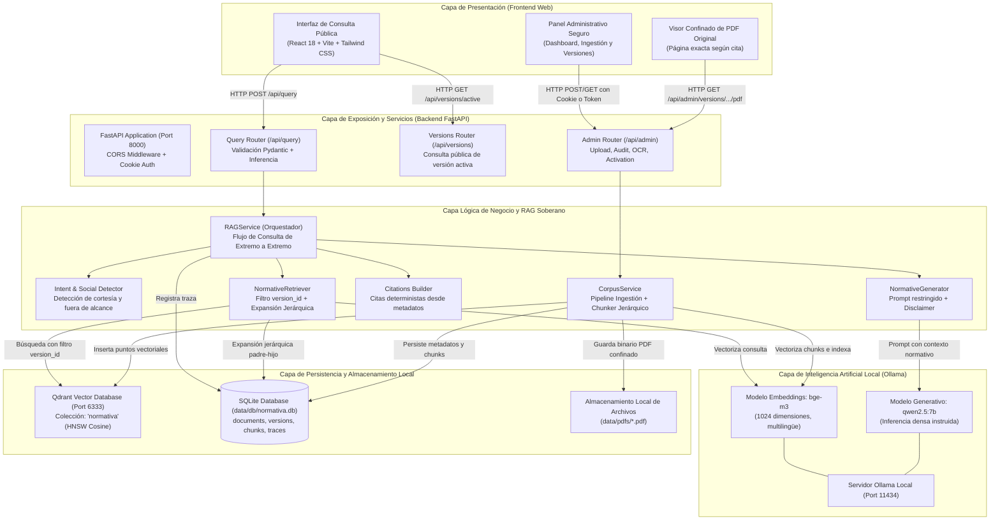
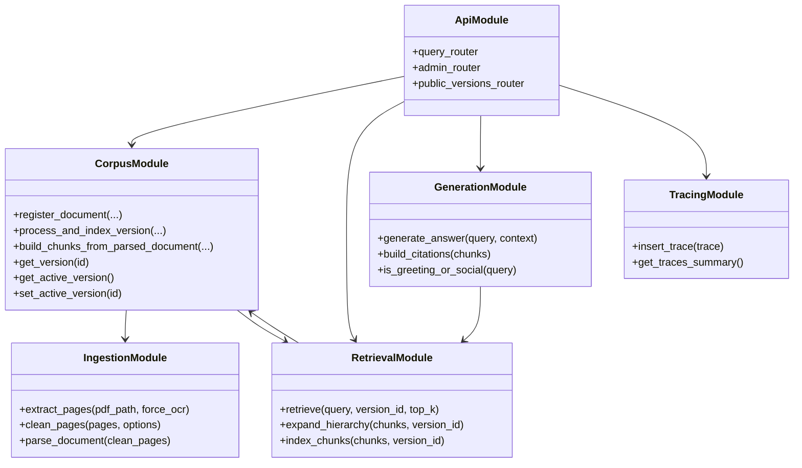
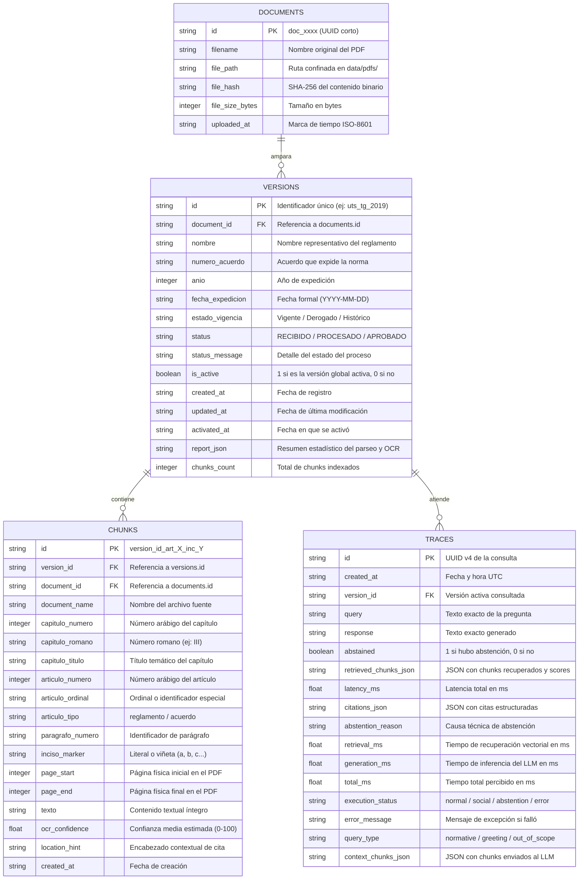
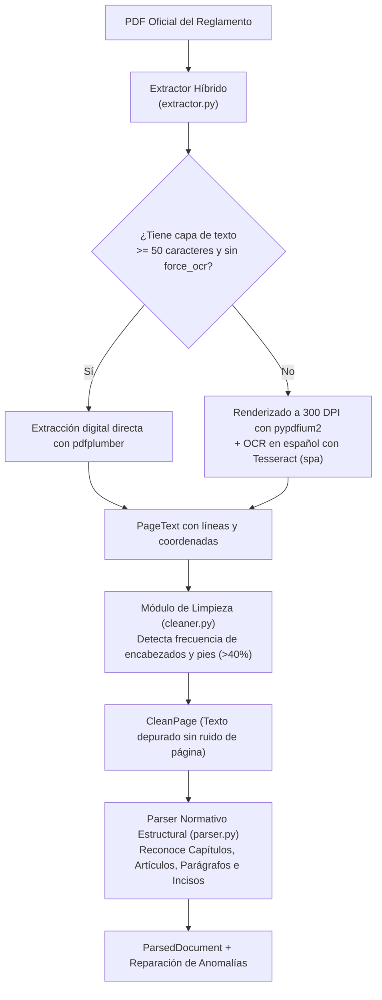
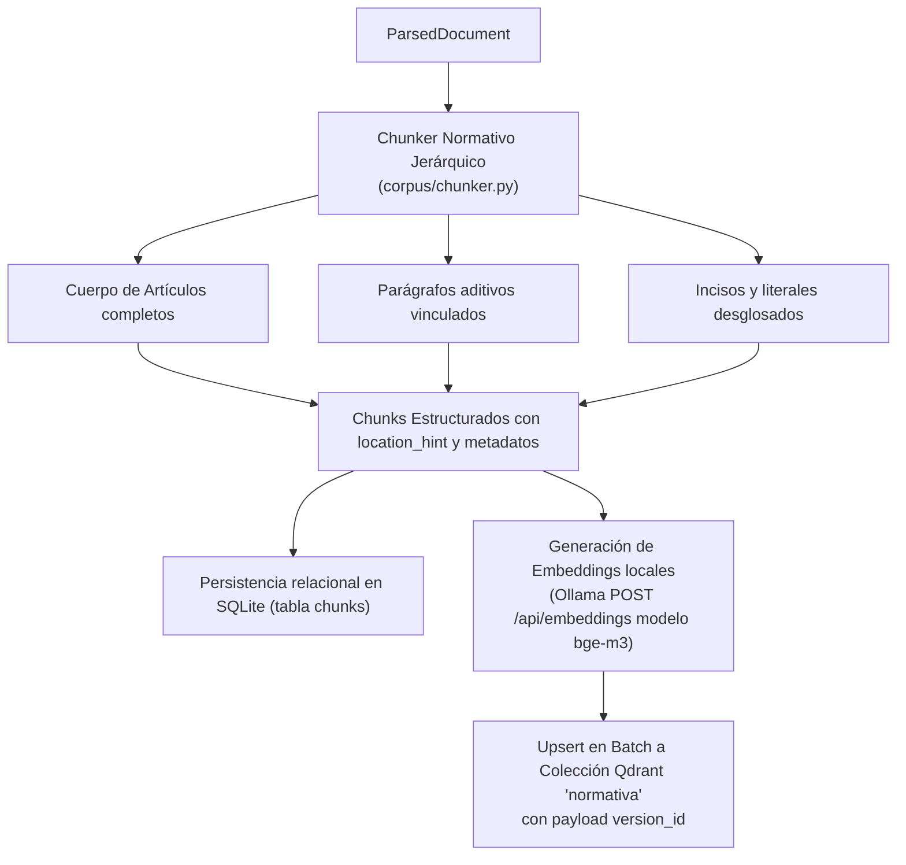
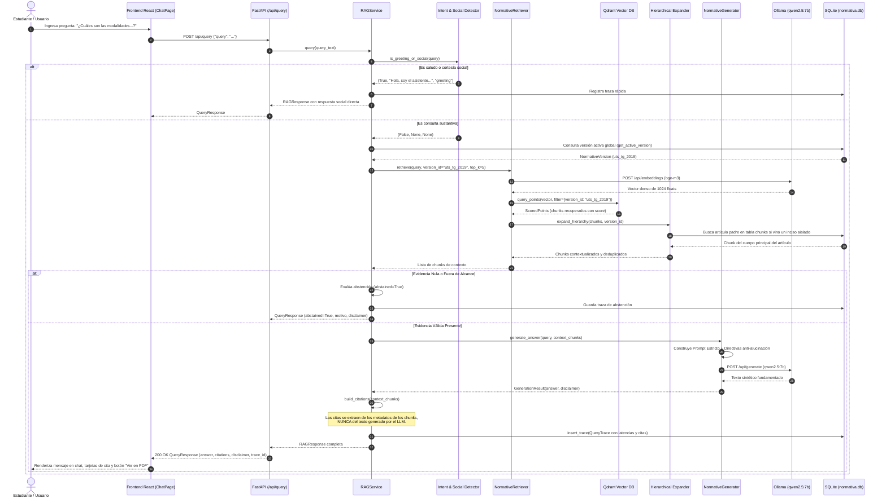

# Paquete de Diseño del Prototipo NORMATIVA-TG UTS
## Documento de Arquitectura y Especificación de Diseño de Software
**Código Institucional:** F-DC-124 / F-DC-125  
**Institución:** Unidades Tecnológicas de Santander (UTS)  
**Fecha de consolidación:** Noviembre de 2026  
**Estado:** Arquitectura Realmente Implementada y Comprobada  

---

## 1. Visión General de la Arquitectura del Sistema

El sistema **NORMATIVA-TG UTS** adopta una arquitectura desacoplada, multicapa y estrictamente soberana (100% de ejecución local). El diseño garantiza que ningún dato, consulta institucional o fragmento documental sea transmitido a través de internet o procesado en plataformas de terceros.



---

## 2. Diagrama de Componentes del Sistema

El backend se organiza en seis módulos cohesivos bajo `src/normativa/`:



---

## 3. Modelo de Datos Relacional (SQLite)

La base de datos relacional opera sobre el motor nativo `sqlite3` de Python en `data/db/normativa.db`. Alberga cuatro tablas diseñadas para mantener la integridad referencial y auditoría:



---

## 4. Estructura de Colecciones y Payloads en Qdrant

La persistencia vectorial reside en **Qdrant**, ejecutado dentro de un contenedor Docker local sobre el puerto `6333`.

### 4.1. Configuración de la Colección `normativa`
- **Dimensión vectorial:** `1024` (coincidente con la arquitectura de embeddings densos de `bge-m3`).
- **Función de distancia:** `Cosine` (Similitud del Coseno, espacio normalizado $[-1, 1]$).
- **Almacenamiento de Payload en disco:** `on_disk_payload: true` para optimizar el consumo de memoria RAM en hardware modesto.
- **Índice HNSW:** `m = 16`, `ef_construct = 100`, con full scan threshold en 10.000 puntos.

### 4.2. Esquema de Payload Almacenado por Punto Vectorial
Cada vector indexado en Qdrant almacena el siguiente payload estructurado:
```json
{
  "chunk_id": "uts_tg_2019_art_8_inc_a",
  "version_id": "uts_tg_2019",
  "document_id": "doc_9fb89774cb",
  "document_name": "reglamento_trabajo_grado.pdf",
  "capitulo_numero": 3,
  "capitulo_romano": "III",
  "capitulo_titulo": "DE LAS MODALIDADES DE TRABAJO DE GRADO",
  "articulo_numero": 8,
  "articulo_ordinal": null,
  "paragrafo_numero": null,
  "inciso_marker": "a",
  "page_start": 4,
  "page_end": 4,
  "location_hint": "Capítulo III - DE LAS MODALIDADES DE TRABAJO DE GRADO, Artículo 8, Inciso a (págs. 4-4)",
  "texto": "Capítulo III - DE LAS MODALIDADES DE TRABAJO DE GRADO. Artículo 8, Inciso a):\nProyecto de Investigación",
  "ocr_confidence": 92.4
}
```
**Índice de Payload en Qdrant:**  
Se crea un índice de tipo `keyword` sobre el campo `version_id`. Esto permite que las consultas realicen un filtrado exacto y en tiempo constante previo a la búsqueda HNSW, evitando el recorrido de vectores pertenecientes a normativas inactivas.

---

## 5. Flujos Principales de Procesamiento y Operación

### 5.1. Flujo de Ingestión Documental, Extracción y OCR
El pipeline de ingestión procesa el documento en cuatro fases sucesivas e inmutables:



### 5.2. Flujo de Segmentación Jerárquica y Vectorización



---

### 5.3. Flujo de Consulta RAG y Generación Fundamentada (Diagrama de Secuencia)

El siguiente diagrama detalla la secuencia exacta que ocurre durante una consulta formulada por un estudiante:



---

## 6. Flujo de Autenticación Administrativa y Seguridad

### 6.1. Mecanismo de Autenticación Híbrido
Para conjugar la facilidad de integración en navegadores web con la automatización mediante scripts de administración, el sistema implementa tres métodos de validación simultáneos en `verify_admin_key`:
1. **Cookie HttpOnly (`admin_session`):** Emitida por el endpoint `/api/admin/login` con directivas `HttpOnly`, `SameSite=Lax` y control de expiración. Previene ataques XSS al impedir que scripts maliciosos lean el token desde JavaScript.
2. **Encabezado `X-Admin-Key`:** Utilizado en peticiones automatizadas de consola o herramientas de integración continua.
3. **Encabezado `Authorization: Bearer <token>`:** Conforme al estándar OAuth2/JWT para interoperabilidad con clientes API.

### 6.2. Protección contra Directory Traversal en Visor de PDF
El endpoint `/api/admin/versions/{version_id}/pdf` entrega el documento original confinado:
```python
# Verificación estricta de ruta canónica
allowed_dir = (Path(settings.DATA_DIR) / "pdfs").resolve()
target_path = Path(document.file_path).resolve()

if not target_path.is_relative_to(allowed_dir):
    raise HTTPException(status_code=403, detail="Acceso denegado: ruta no autorizada")
```

---

## 7. Justificación de Decisiones Tecnológicas

| Tecnología Seleccionada | Alternativas Descartadas | Justificación Técnica de la Elección |
| :--- | :--- | :--- |
| **Python 3.12 + uv** | Pipenv, Poetry, Conda | `uv` ofrece velocidades de resolución de dependencias hasta 50x superiores, bloqueo determinista (`uv.lock`) y compatibilidad nativa con entornos virtuales modernos. |
| **FastAPI** | Flask, Django REST | Rendimiento asíncrono superior (Starlette/Uvicorn), validación estricta de esquemas con Pydantic v2 y generación automática de documentación interactiva OpenAPI. |
| **Qdrant (Docker)** | ChromaDB, Pinecone, Milvus | Motor vectorial nativo en Rust de consumo ultrabajo de RAM, soporte de almacenamiento de payload en disco, persistencia simple en archivo y filtrado de metadatos estricto de altísima velocidad. |
| **Ollama Local** | LM Studio, vLLM, OpenAI API | Garantiza la soberanía del dato exigida por la normativa UTS (cero fuga a la nube); gestión de modelos simplificada por línea de comandos y consumo predecible de recursos en hardware local. |
| **Embeddings `bge-m3`** | text-embedding-ada-002, all-MiniLM | Arquitectura densa de 1024 dimensiones líder en comprensión semántica de español normativo; supera a modelos compactos en el emparejamiento de terminología jurídica y académica. |
| **LLM `qwen2.5:7b`** | Llama-3-8B, Mistral-7B, DeepSeek | Extraordinaria capacidad de seguimiento estricto de instrucciones en español (`instruction following`), mínimo índice de alucinación cuando se le provee contexto acotado y excelente razonamiento normativo. |
| **SQLite (`sqlite3`)** | PostgreSQL, MySQL | Simplicidad absoluta sin sobreingeniería: cero mantenimiento de servidores adicionales, almacenamiento en archivo único transaccional (ACID) y portabilidad completa en el repositorio. |
| **React + Vite + Tailwind** | Next.js, Angular, Vue | Empaquetado instantáneo con HMR veloz, tipado integral con TypeScript, diseño moderno y sobrio con los colores corporativos UTS (verde y dorado institucional). |

---
*Fin del Documento 02 — Paquete de Diseño del Prototipo.*
