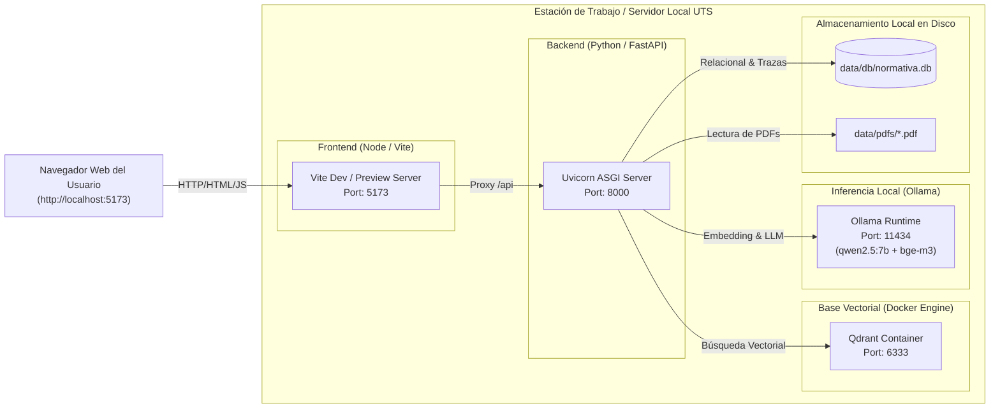

# Documentación de Despliegue del Sistema NORMATIVA-TG UTS
## Guía de Preparación, Puesta en Marcha, Demostración y Operación Local
**Código Institucional:** F-DC-124 / F-DC-125  
**Institución:** Unidades Tecnológicas de Santander (UTS)  
**Fecha de consolidación:** Noviembre de 2026  
**Entorno Objetivo:** Despliegue Local Soberano (On-Premise / Estación de Trabajo)  

---

## 1. Entorno de Ejecución y Topología de Red

El despliegue de **NORMATIVA-TG UTS** se concibió bajo una topología de computación soberana en un solo host local, eliminando cualquier costo de suscripción a nubes comerciales (AWS, GCP, Azure, OpenAI) y blindando la información institucional.



### 1.1. Matriz de Puertos y Servicios de Red

| Servicio | Binario / Contenedor | Puerto Local | Protocolo | Propósito |
| :--- | :--- | :---: | :---: | :--- |
| **Frontend Web** | `vite` | **5173** | HTTP | Entrega de interfaz React + Tailwind al navegador. |
| **Backend REST** | `uvicorn` (FastAPI) | **8000** | HTTP | API REST de consulta, administración y visor PDF. |
| **Base Vectorial** | `qdrant/qdrant` | **6333** | HTTP / REST | Motor de búsqueda de similitud coseno y filtrado. |
| **Servidor LLM** | `ollama` | **11434** | HTTP | Generación de lenguaje e incrustaciones vectoriales. |

---

## 2. Dependencias de Software Requeridas

Antes de iniciar el despliegue, la estación de trabajo debe contar con:
1. **Linux (Ubuntu 22.04 LTS / Debian 12 o superior)** con privilegios sudo.
2. **Docker Engine y Docker Compose** v2+.
3. **Python 3.12** y el gestor de paquetes **`uv`** (Astral).
4. **Node.js 18 LTS** o superior y gestor `npm`.
5. **Tesseract OCR** con paquete de idioma español (`tesseract-ocr`, `tesseract-ocr-spa`).
6. **Ollama** v0.3+ instalado con los modelos `qwen2.5:7b` y `bge-m3`.

---

## 3. Procedimiento de Instalación Paso a Paso

### 3.1. Clonación del Repositorio y Permisos
```bash
git clone <URL_DEL_REPOSITORIO_UTS>
cd FastAPIProject2
chmod +x scripts/*.py
```

### 3.2. Configuración de Variables de Entorno
Si no existe el archivo `.env`, créelo copiando la plantilla base:
```bash
cp .env.example .env
```
Verifique que los valores coincidan con la configuración local:
```env
OLLAMA_BASE_URL=http://localhost:11434
LLM_MODEL=qwen2.5:7b
EMBED_MODEL=bge-m3
QDRANT_URL=http://localhost:6333
QDRANT_COLLECTION=normativa
SQLITE_PATH=data/db/normativa.db
DATA_DIR=data
ADMIN_API_KEY=dev-admin-secret-key
OCR_CONFIDENCE_THRESHOLD=75.0
RAG_TOP_K=5
```

### 3.3. Instalación de Dependencias de Backend y Frontend
```bash
# 1. Dependencias del Backend Python con uv
uv sync

# 2. Dependencias del Frontend Node con npm
cd frontend
npm install
cd ..
```

---

## 4. Procedimiento de Inicio y Apagado del Sistema

### 4.1. Secuencia de Inicio (Script de Arranque Automático)
Para iniciar la plataforma completa de forma ordenada, ejecute los siguientes comandos en terminales separadas (o mediante un script de orquestación):

```bash
# Paso 1: Iniciar Qdrant Vector DB
docker compose up -d

# Paso 2: Verificar Ollama (debe estar sirviendo en segundo plano)
ollama serve &

# Paso 3: Iniciar Backend FastAPI
uv run uvicorn normativa.api.main:app --host 0.0.0.0 --port 8000

# Paso 4: Iniciar Frontend Vite (en otra terminal)
cd frontend
npm run dev -- --host 0.0.0.0 --port 5173
```

### 4.2. Secuencia de Verificación Inmediata de Salud
Compruebe el correcto funcionamiento de cada servicio mediante `curl`:
```bash
# Verificar Backend FastAPI
curl -s http://localhost:8000/health
# Respuesta esperada: {"status":"ok"}

# Verificar Versión Activa en Backend
curl -s http://localhost:8000/api/versions/active
# Respuesta esperada: {"active_version": {...}, "has_active_version": true}

# Verificar Qdrant
curl -s http://localhost:6333/collections/normativa
# Respuesta esperada: {"result":{"status":"green", "points_count": 362...}}

# Verificar Ollama
curl -s http://localhost:11434/api/tags
# Respuesta esperada: Lista de modelos incluyendo qwen2.5:7b y bge-m3
```

### 4.3. Procedimiento de Apagado Ordenado
Para detener el entorno sin riesgo de corrupción de datos:
1. Detener el servidor Vite presionando `Ctrl + C` en su terminal.
2. Detener el servidor Uvicorn presionando `Ctrl + C` en su terminal.
3. Detener el contenedor de Qdrant:
   ```bash
   docker compose stop
   ```

---

## 5. Requisitos de Infraestructura y Estimación de Consumo

| Recurso de Hardware | Requisito Mínimo | Requisito Recomendado | Consumo Observado en Pruebas |
| :--- | :--- | :--- | :--- |
| **CPU** | 4 núcleos (x86_64) | 8 núcleos (3.0 GHz+) | 40% a 70% durante inferencia LLM en CPU. |
| **RAM del Sistema** | 16 GB | 32 GB | ~9.5 GB totales (Qdrant: 250 MB, Ollama: 6 GB, Backend: 150 MB, SO: 3 GB). |
| **VRAM (GPU NVIDIA)** | No obligatoria | 6 GB a 8 GB (RTX 3060+) | Inferencia en 2 a 5 segundos por respuesta con GPU. |
| **Disco Duro** | 20 GB libres | 50 GB SSD NVMe | El repositorio + modelos Ollama ocupan aprox. 8.5 GB. |

---

## 6. Limitaciones del Despliegue Local

1. **Concurrencia de Usuarios:** Al operar con inferencia LLM local en hardware de estación de trabajo sin clúster de GPUs, el sistema está diseñado para atender consultas secuenciales o de concurrencia moderada (1 a 5 usuarios simultáneos).
2. **Latencia en CPU Pura:** Si la máquina no cuenta con GPU compatible con CUDA, la generación de texto de 7B parámetros requiere entre 25 y 50 segundos por consulta. Para una sustentación o demostración en vivo, se recomienda ejecutar sobre equipo con aceleración gráfica o precargar las respuestas en el historial.

---

## 7. Procedimiento para Realizar una Demostración Académica o Sustentación

Para sustentar el proyecto ante los evaluadores y directores con total éxito:

1. **Preparación Previa (15 minutos antes):**
   - Inicie Qdrant (`docker compose up -d`), Ollama, FastAPI y Vite.
   - Abra el navegador en `http://localhost:5173`.
   - Abra una segunda pestaña en `http://localhost:5173/admin` e inicie sesión administrativa.
2. **Demostración 1 — Consulta Directa y Citas:**
   - En el chat público, formule: *«¿Cuáles son las modalidades de Trabajo de Grado?»*.
   - Muestre la enumeración de las 6 modalidades del Artículo 8.
   - Haga clic en una tarjeta de cita para desplegar el texto oficial.
   - Presione el botón **«Ver en PDF»** para mostrar la página 4 del reglamento original escaneado.
3. **Demostración 2 — Detección de Excepciones y Parágrafos:**
   - Formule: *«¿La modalidad de seminario admite prórroga?»*.
   - Muestre cómo el sistema detecta que no se concede prórroga según el parágrafo 1 del artículo 15.
4. **Demostración 3 — Honestidad y Abstención:**
   - Formule: *«¿Cuánto cuesta una hamburguesa en la cafetería?»* o *«¿Cuánto vale el seminario en pesos?»*.
   - Demuestre que el sistema activa el estado de abstención sin alucinar citas inventadas.
5. **Demostración 4 — Panel Administrativo y Aislamiento:**
   - En la pestaña administrativa, muestre el Dashboard de métricas y la auditoría OCR.
   - Demuestre la capacidad de alternar entre normativas en tiempo real.

---
*Fin del Documento 09 — Documentación de Despliegue del Sistema.*
