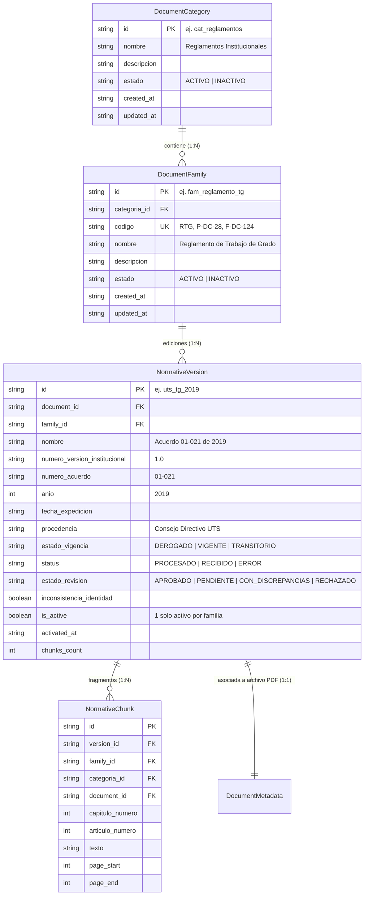

# Arquitectura Documental y Reglas de Negocio — Iteración 2 (Etapa 1)

**Proyecto**: NORMATIVA-TG UTS  
**Propuesta de Grado**: Código 65-2026-127 (F-DC-124)  
**Iteración**: 02 — Etapa 1 de 5 (Gestión documental y versionamiento)  

---

## 1. Modelo Conceptual Jerárquico de Tres Niveles

Para responder a la necesidad de gestionar múltiples tipos de documentos institucionales (Reglamentos, Procedimientos del SGI y Formatos de Trabajo de Grado) sin mezclar versiones ni perder el rigor normativo, se diseñó la siguiente jerarquía:



---

## 2. Implementación de las 17 Reglas de Negocio

A continuación se detalla cómo se garantizan las 17 reglas de negocio solicitadas:

1. **Una categoría puede contener múltiples familias documentales**: Implementado mediante la clave foránea `families.categoria_id REFERENCES categories(id)`.
2. **Una familia pertenece a una categoría**: Cardinalidad estricta 1:N sin familias huérfanas (`NOT NULL`).
3. **Una familia puede contener múltiples versiones**: Clave foránea `versions.family_id REFERENCES families(id)`.
4. **Cada versión pertenece a una única familia**: Integridad referencial con `family_id NOT NULL`.
5. **Solo puede existir una versión activa por familia documental**: Garantizado a nivel de motor SQLite mediante un **índice único condicional**:
   ```sql
   CREATE UNIQUE INDEX IF NOT EXISTS idx_versions_active_per_family 
   ON versions(family_id) WHERE is_active = 1;
   ```
   Esto imposibilita a nivel físico que existan dos versiones activas para la misma familia.
6. **Múltiples familias con versiones activas simultáneamente**: Dado que el índice único parcial se indexa por `family_id`, el sistema soporta que `fam_reglamento_tg`, `fam_p_dc_28` y `fam_f_dc_124` tengan simultáneamente una versión con `is_active = 1`, conformando un **corpus normativo activo multi-documental**.
7. **Activar una nueva versión desactiva la versión anterior de esa misma familia**: En `db.activate_version()`:
   ```sql
   UPDATE versions SET is_active = 0, updated_at = ? WHERE family_id = ? AND is_active = 1;
   UPDATE versions SET is_active = 1, activated_at = ?, updated_at = ? WHERE id = ?;
   ```
8. **La activación de una versión no desactiva documentos de otras familias**: El `UPDATE` condiciona estrictamente `WHERE family_id = ?`, dejando intactas las otras familias.
9. **Las versiones desactivadas se conservan y pueden reactivarse**: Ningún documento es destruido al ser reemplazado; permanece histórico con `is_active = 0`.
10. **Rechazo de activación de versiones incompletas o no aprobadas**: Se verifica que `status == 'PROCESADO'` y `estado_revision != 'RECHAZADO'`. De lo contrario se levanta `ValueError`.
11. **Bloqueo de versiones con discrepancias de identidad**: Si `inconsistencia_identidad == True`, `db.activate_version()` rechaza la solicitud de manera inmediata.
12. **Independencia entre vigencia institucional y activación técnica**: El campo `estado_vigencia` (`VIGENTE`, `DEROGADO`, `TRANSITORIO`) es puramente normativo. Un documento derogado puede activarse para fines de auditoría histórica sin que el software altere su etiqueta institucional.
13. **No interpretar activación como vigencia**: La interfaz gráfica presenta claramente ambas etiquetas por separado (Vigencia institucional vs Estado de activación en motor RAG).
14. **Operaciones transaccionales y protección frente a concurrencia**: La activación ejecuta `conn.execute("BEGIN IMMEDIATE")` en SQLite, bloqueando escrituras concurrentes que pudieran causar condiciones de carrera.
15. **Detección de duplicados SHA-256**: Función `detect_sha256_duplicates()` en `CorpusService.register_document()`. Si un archivo tiene un hash idéntico a uno previo pero metadatos divergentes (ej. año o acuerdo diferente), se marca automáticamente con `inconsistencia_identidad = True` y `estado_revision = 'CON_DISCREPANCIAS'`.
16. **Protección contra eliminación destructiva**: Se implementó validación de conteo de referencias previas a cualquier `DELETE`. No se permite borrar una categoría con familias ni una familia con versiones.
17. **Integridad de referencias históricas y trazas**: La tabla `traces` almacena de forma inmutable `authorized_versions_json`, registrando exactamente cuáles versiones componían el corpus activo al instante en que el usuario formuló su pregunta.
