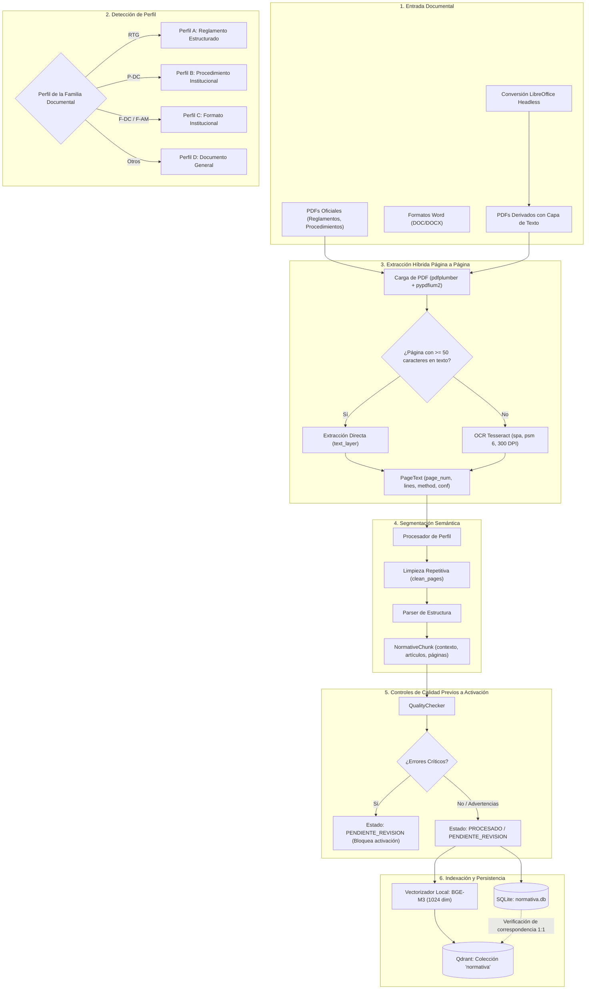

# Diagrama del Pipeline de Extracción e Indexación — Etapa 2
## NORMATIVA-TG UTS

---

## 1. Arquitectura General del Pipeline de Ingestión

---

## 2. Decisiones Técnicas Clave

1. **Decisión de extracción por página**: Cada página evalúa de forma autónoma si posee suficiente texto en la capa digital. El OCR solo se ejecuta en páginas escaneadas o vacías, garantizando velocidad y máxima fidelidad textual.
2. **Perfiles desacoplados**: La selección del procesador se define en la tabla `families.perfil_procesamiento`, permitiendo asociar cualquier documento a un perfil sin tocar el código fuente.
3. **Bloqueo preventivo de activación**: Documentos con discrepancias de acuerdo/año, artículos faltantes o desincronización entre SQLite y Qdrant quedan bloqueados para activación oficial.
