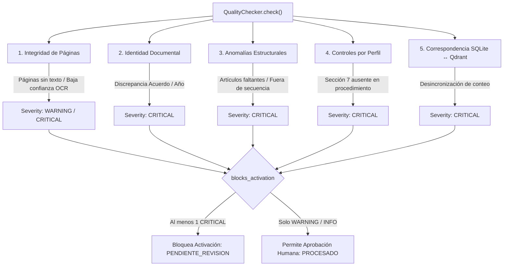

# Informe de Calidad Documental y Advertencias — Etapa 2
## NORMATIVA-TG UTS

**Fecha:** 2026-11-27  
**Módulo:** `src/normativa/ingestion/quality/checker.py` (`QualityChecker`)

---

## 1. Controles de Calidad Implementados

El sistema implementa controles automáticos previos a la activación organizados por perfil:

### Clasificación de Severidad:
- **CRITICAL**: Bloquea de forma obligatoria la activación de la versión en el sistema.
- **WARNING**: Advertencia que no bloquea pero debe presentarse al administrador para revisión humana.
- **INFO**: Información de trazabilidad del procesamiento.

---

## 2. Advertencias y Hallazgos por Documento

### 2.1 Reglamento 2021 (`reglamento_2021.pdf`)
- **Estado de Calidad:** `SIN ERRORES CRÍTICOS`
- **Páginas procesadas:** 27 de 27 por `text_layer` nativo con `pypdfium2`.
- **Artículos:** 74/74 identificados en secuencia continua (1 a 74).
- **Advertencias documentales de la fuente:**
  - *Artículo 4:* Se detectó un literal 'a' repetido tras el literal 'f' en el documento original. No se forzó una corrección artificial de la numeración; se representaron ambos literales conservando su orden documental físico (`inc_a` e `inc_a_bis`), su texto íntegro y la advertencia en los metadatos.
- **Contaminación del margen vertical:** Erradicada al 100% en los 35 artículos señalados (0 palabras fragmentadas residuales).
- **Artículos multi-página:** 18 identificados y vinculados correctamente.
- **Revisión humana:** Marcada como `PENDIENTE_REVISION_HUMANA` (210 chunks totales: 74 artículos + 3 fragmentos estructurales).

### 2.2 Reglamento 2019 (`Acuerdo 01-021`)
- **Estado:** Histórico en base de datos (`is_active = 1` como única versión activa hasta que se complete y apruebe la revisión humana de 2021).
- **Disponibilidad documental:** Disponible y verificado en `documentos_fuente/reglamentos/reglamento_2019.pdf` (19 páginas auténticas, extracción OCR, 181 chunks).
- **Acción:** Preservado íntegramente con sus 181 chunks y 64 artículos como versión histórica oficial. No se altera ni se elimina.

### 2.3 Versión con Discrepancias (`reglamento_trabajo_grado-1`)
- **Estado:** Bloqueada (`CON_DISCREPANCIAS`, `is_active = 0`).
- **Motivo:** Coincidencia SHA-256 con documento de 2019 pero con metadatos declarados de 2021.
- **Acción:** Se mantiene bloqueada y preservada como evidencia histórica.

### 2.4 Procedimientos P-DC-28 y P-DC-29
- **Estado de Calidad:** `VERIFICADO`
- **Estructura de Actividades por Subnumeral:**
  - P-DC-28: 27 actividades estructuradas (7.1: 8 actividades, 7.2: 11 actividades, 7.3: 8 actividades).
  - P-DC-29: 16 actividades estructuradas (7.1: 8 actividades, 7.2: 8 actividades).
- **Desambiguación:** Cada actividad incluye en metadatos y location_hint su subnumeral y modalidad respectiva, evitando confusiones entre actividades homónimas.
- **Fragmentos intro limpios:** `numeral_7_intro` libre de volcados desordenados de tablas.
- **Control de presupuesto de tokens:** Numeral 3 de P-DC-28 (11.386 chars) dividido en 4 subfragmentos bajo límite de tokens (`_p1` a `_p4`).

### 2.5 Formatos Institucionales (9 Formatos)
- **Estado de Calidad:** `VERIFICADO`
- **F-DC-124:** Relación campo-instrucción en página 1 corregida (campos de fecha no se intercalan en instrucciones de título).
- **F-DC-126:** Se identificó que el PDF derivado cuenta con 3 páginas mientras el encabezado institucional indica "PÁGINA: X DE: 2". La verificación determinó que la plantilla original Word requiere 3 páginas para albergar todas sus tablas y firmas institucionales sin pérdida de contenido. Se conservan tanto el archivo Word original como el PDF de 3 páginas sin alterar el texto institucional.
- **Advertencia metodológica:** Los formatos son plantillas vacías autorizadas y no tienen rango normativo derogatorio.
